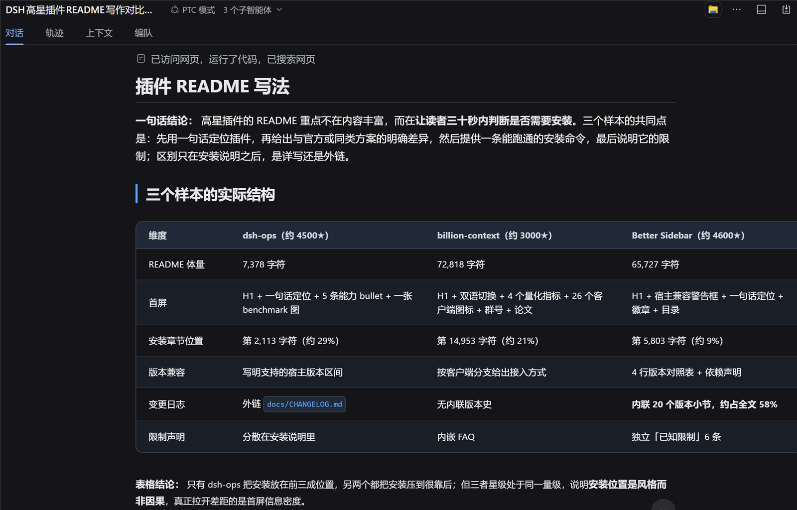
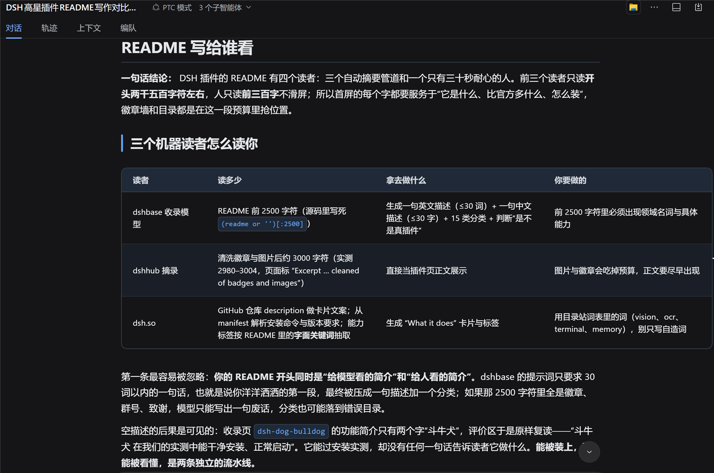
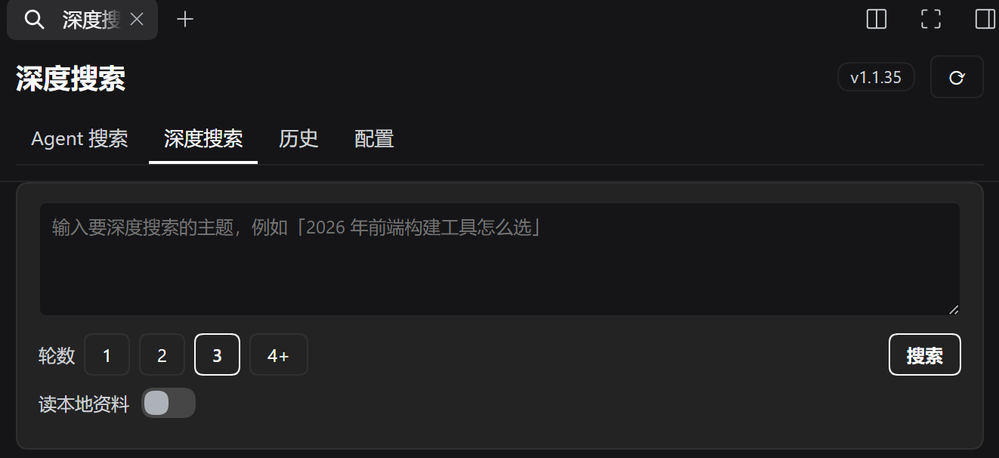

# dsh-deepsearch

<p align="center">
  
</p>

<p align="center">
  <a href="README.md">中文</a> · <b>English</b>
</p>

<p align="center">
  <b>Multi-round deep research</b> — one session keeps drilling into the same topic, round after round.
</p>

<p align="center">
  A single agent search answers once. This keeps digging: what is still missing, what the evidence says, and what to look at next.
</p>

<p align="center">
  <a href="https://opensource.org/licenses/MIT"></a>
  <a href="https://www.npmjs.com/package/@deepseek-ai/dsh"></a>
  <a href="https://github.com/NeptuneRY/dsh-deepsearch/stargazers"></a>
</p>

`dsh plugin add dsh-deepsearch` · requires DSH `0.2.1-rc.1+` · adds a **Deep search** tab to the right sidebar

## Why use it

One agent search turns a question into one answer. Deep search puts the same topic into **one session** and runs several rounds:

- round 1 breaks the topic into sub-questions and nails down the facts;
- every later round inherits the whole context, works out what is still open, and digs there;
- leads that surfaced in a round get carried into the next one — that is where angles you would never have asked for come from.

A finished multi-round report is worth far more than a single agent search: it reads like someone spent days on the topic, not like paragraphs stitched from a few pages.

It is not investment-only: industry and company research, due diligence, option comparison, product selection, technical evaluation — anything complex where the answer is not on the first page. For one fact, a couple of links or a definition, the built-in `web_search` is faster; this plugin is for questions worth three days.

It never replaces a host tool: `web_search` / `web_fetch` stay native, and the model decides whether retrieval is worth delegating to sub-agents.

### How it differs from a single agent search

| | Single agent search | Deep search |
| --- | --- | --- |
| Context | starts from scratch each time | one session, each round inherits the last |
| Splitting | decided once | re-planned every round; open items become next round's focus |
| Output | one answer | one Markdown report per round, numbered in one topic folder |
| Best for | facts, links, definitions | research that needs depth and cross-checking |

### Two rounds, one report rewritten

Topic: *"How should a DSH plugin README be written?"* — two rounds:





Round 1 compares three samples side by side: size, what sits above the fold, where the install section lands, how the changelog is handled. Round 2 does not redo that table: it collapses the findings into "the first 2500 characters decide how the directory describes you" and reorders the sections accordingly.

What round 2 inherits is round 1's **judgement**, not round 1's file — that is the difference between multi-round and asking twice.

## Two entry points

### Panel

The **Deep search** tab in the right sidebar, four pages:

| Page | What it does |
| --- | --- |
| **Deep search** | Enter a topic, pick rounds (1–10). Reports go to `<reportDir>/<short topic>/NN-<title>.md`; rounds run in the same session and are saved one by one, so a failed round never loses the earlier ones |
| **Agent search** | Enter a question in natural language; opens a session in the "Deep search" workspace and syncs the answer back. The session stays in the sidebar for follow-ups |
| **History** | Filter by All / Agent search / Deep search; click a card to expand, and "search one more round" continues the original session |
| **Config** | General options, deep search parameters, method notes |



Result cards and history cards can save a report to the desktop: one file straight to the desktop, multi-round reports into a folder named after the topic, with `-2` suffixes when names collide.

### The `deepsearch` tool

Callable from any main session; it uses exactly the same pipeline as the panel.

- Arguments: `topic` (required), `rounds` (1–10; above 1 means multi-round), `use_context`, `reference_paths` (extra files or folders to read).
- Returns `{ ok, title, reportPath, ms, summary, rounds }`; the body is the summary truncated to `deepsearchSummaryChars`, the full report stays on disk.
- Inside the deep-search workspace it runs a single round by default so nesting cannot hold the parent hostage; the cap can be lifted in settings.

## Install

From the market: open the DSH plugin market, search `dsh-deepsearch`, install, then restart the host — bundles are only assembled at startup.

From the command line:

```bash
dsh plugin add dsh-deepsearch        # desktop profile by default; add --profile <name> for another one
dsh plugin remove dsh-deepsearch     # uninstall
```

You are done when a **Deep search** tab shows up in the right sidebar. If it does not, check two things first: the host was restarted, and you installed into the profile you are actually running.

The sidebar tab is registered through the `betterSidebar` service provided by **Better Sidebar** (`dsh-better-sidebar`); without it the plugin falls back to the host's built-in sidebar slot and works the same.

## Compatibility

The current version requires DSH **0.2.1-rc.1** or newer (declared in `engines.dsh`, checked by the host before installing). Earlier 0.2.x previews lack `ctx.tools.restrict` and `sessionController`, so the plugin loads but never activates.

The sidebar panel relies on **Better Sidebar** (`dsh-better-sidebar`); the host's built-in sidebar slot is the fallback, with the same behaviour.

## Quick start

1. Open **Deep search** in the right sidebar.
2. Type a topic, choose 3 rounds.
3. Wait for it to finish; the report is on the result card, one click away from the desktop.
4. Want more? Hit "search one more round" in history.

## Data and configuration

The data directory defaults to `~/.dsh-deepsearch` (`%USERPROFILE%\.dsh-deepsearch` on Windows). Runtime options live in `config.json` there and can be changed in the panel.

```
~/.dsh-deepsearch/
  config.json      # behaviour options
  history.json     # panel history
  workspace/       # sidebar workspace used by panel sessions
  reports/         # default report folder (when reportDir is empty)
  drafts/          # unfinished drafts
```

<details>
<summary>All configuration keys</summary>

| Key | Default | Meaning |
| --- | --- | --- |
| `workspaceId` | `''` | Workspace id for panel sessions; empty means the "Deep search" workspace |
| `maxToolCalls` | `8` | Cap on `web_search` / `web_fetch` for panel Agent-search sessions (prompt only) |
| `panelAgentTimeoutSec` | `180` | Panel Agent-search timeout (seconds) |
| `searchReasoningEffort` | `low` | Reasoning effort for Agent search: `off` / `low` / `high` / `max`; applied after the session is created |
| `historyLimit` | `20` | How many history entries the panel keeps |
| `dataRoot` | `~/.dsh-deepsearch` | Where config, history and the search workspace live |
| `reportDir` | `''` | Report folder; empty means `<dataRoot>/reports`, an absolute path writes there |
| `deepsearchTimeoutSec` | `1200` | Total timeout for one deep search (seconds) |
| `deepsearchReasoningEffort` | `low` | Reasoning effort on the deep search page: `off` / `low` / `high` / `max` |
| `deepsearchToolCalls` | `24` | Search/fetch tool-call budget for one deep search |
| `deepsearchMaxChars` | `20000` | Max characters in a report (truncated with a note beyond it) |
| `deepsearchSummaryChars` | `4000` | Max characters the `deepsearch` tool returns to the agent; the report file is unaffected |
| `noTimeout` | `false` | No time limits anywhere; if it stalls, only reloading the plugin helps |
| `deepsearchSubagents` | `3` | How many sub-agents deep search may fan out (0 = none, do it all in-session) |
| `deepsearchBriefWords` | `900` | Word cap per sub-agent brief (0 = unlimited) |
| `deepsearchPtc` | `false` | New deep-search sessions use the `ptc` preset; falls back to the default preset with a diagnostic entry |
| `deepsearchCompress` | `false` | Whether deep-search sessions may use the host's context compression tool. Off by default: no `compress` tool is registered, so the research trail stays intact |
| `methodBundled` | `true` | Inject the bundled `methods.md`; off means no method notes at all |
| `deepsearchEnabled` | `true` | Whether ordinary sessions see the `deepsearch` tool |
| `deepsearchWorkspaceToolEnabled` | `false` | Whether the deep-search workspace also sees `deepsearch`; off by default, and calls inside the workspace run a single round |
| `deepsearchWorkspaceUnlimited` | `false` | Lift the one-round cap inside the workspace; shown only when the workspace tool is on |
| `referencePaths` | `''` | Absolute files/folders deep search may read (one per line) |
| `referenceEnabled` | `true` | Master switch for reading local references; paths are kept when off |
| `deepsearchRounds` | `1` | Default round count (1–10); the panel has 1/2/3 buttons, 4+ is typed |
| `debug` | `false` | Write mount and failure details to the host log |

Numeric fields carry `min`/`max` and are clamped server-side; the settings card only submits the keys you changed.

</details>

## How it works

- **Sessions**: the panel creates a normal root session via `workspaceRegistry` + `sessionController`; it shows up under the "Deep search" workspace in the sidebar and can be reopened for follow-ups. Not a sub-agent.
- **Rounds**: each round continues in the same session and inherits the previous context instead of re-reading files; every round still writes its own report, so a failure only costs that round.
- **Writing**: the session returns Markdown, the host writes the files — the report folder never needs write access from the session. The plugin writes files only: no index updates, no git.
- **Method notes**: when enabled, `methods.md` is injected once per deep search; disabled means nothing is injected.
- **Visibility**: the `deepsearch` tool is masked per agent via `tools.restrict`, not by prompt instructions.

## What the model sees

- **Tool description**: `deepsearch`'s `description` is the only trigger text, roughly 300 characters covering when to use it, when not to, and the single-round rule inside the workspace.
- **Context**: results return a `deepsearchSummaryChars` summary (4000 characters by default); the full report is on disk and can be read on demand.
- **Compression**: deep-search sessions do not get the host's `compress` tool by default, so a long run is not folded mid-flight; enable it in settings to hand control back to the host policy.
- **KV cache**: every round changes the request prefix, so cache hit rate drops as rounds accumulate — the inherent cost of multi-round.

## FAQ

- **No "Deep search" tab after install**: usually a missing restart, or the wrong profile. Run `dsh plugin --profile <yours> why dsh-deepsearch`.
- **Page still shows the old build after an upgrade**: the panel is a bundle injected into the host; toggling the plugin off and on is faster than a full restart, and a page refresh is enough for panel-only changes.
- **A round failed and only a draft is left**: each round is saved separately; the failed round's text lands in `~/.dsh-deepsearch/drafts/`, earlier rounds are untouched.
- **A long run seems stuck**: the default is 20 minutes per round, scaled by round count (up to 4 hours). If it is really stuck, reload the plugin; "no time limit" removes the watchdog entirely.

## Known limitations

- Report file names come from the first `#` heading (falling back to a truncated topic, with `-2` on collisions); a write failure errors out and the draft goes to `dataRoot/drafts/`.
- Panel Agent search has no result cache; the same question starts a new session.
- Panel sessions are only prompt-constrained to research; there is no hard tool allowlist.
- The reasoning-effort setting is applied when a session is created; changing it mid-run does not affect a running session.

## Changelog

Recent changes live in [CHANGELOG.md](CHANGELOG.md).

## License

[MIT](LICENSE)
