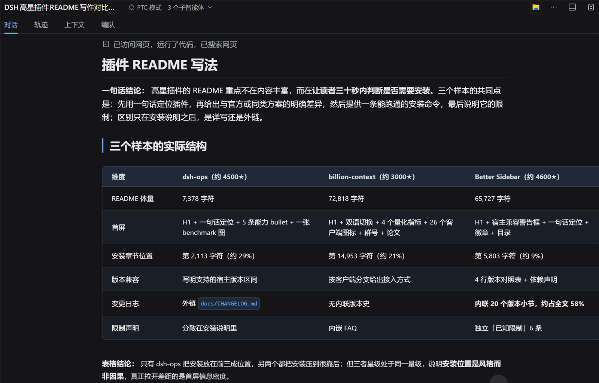
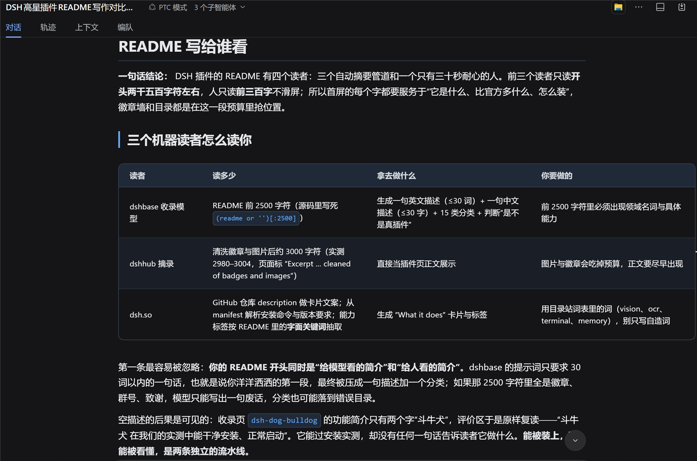
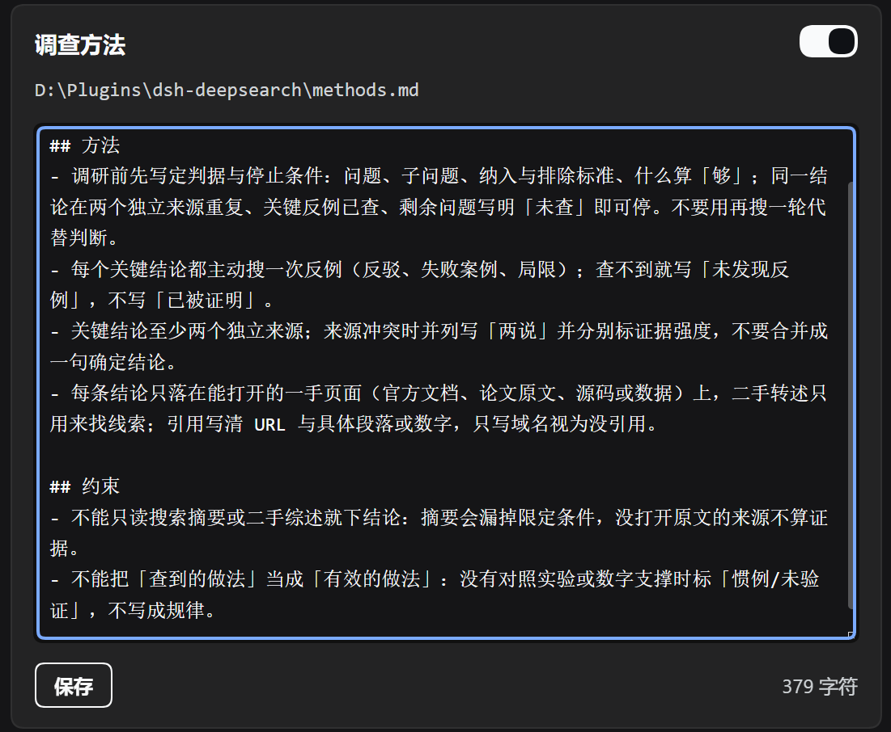

# dsh-deepsearch

<p align="center">
  
</p>

<p align="center">
  <b>中文</b> · <a href="README.en.md">English</a>
</p>

<p align="center">
  <b>多轮深度搜索</b>：同一个会话里一轮接一轮往下挖，每一轮都从上一轮停下的地方继续。
</p>

<p align="center">
  一次 Agent 搜索是「问一次、答一次」；这里是「查完一轮、想清楚还缺什么、再查一轮」，最后那份报告才有纵深。
</p>

<p align="center">
  <a href="https://opensource.org/licenses/MIT"></a>
  <a href="https://www.npmjs.com/package/@deepseek-ai/dsh"></a>
  <a href="https://github.com/NeptuneRY/dsh-deepsearch/stargazers"></a>
</p>

## 为什么用它

深度搜索不是「把 Agent 搜索连跑几轮」。它换了一个做法：主会话拆题、派活、汇总，检索并行摊开。

- **拆**：主会话把主题拆成互不重叠的子问题；
- **派**：每个子问题交给一个**独立子代理**并行查（默认 3 个，最多 8 个）。子代理看不到彼此，各自检索、打开原文、交叉核对；
- **挖**：一轮查完，主会话先看还缺什么——上一轮的「未决」变成下一轮的重点，同一会话继续往下；
- **汇**：每轮落一份带引用的报告，写进同一个主题目录，按编号顺序读。

检索本身走宿主提供的 `web_search` / `web_fetch`，也就是 DeepSeek 的搜索 API。插件不接管它们，只决定「查什么、谁去查、查到哪一步算够」。

### 单轮就已经超过一次 Agent 搜索

一次 Agent 搜索是一个上下文、一条串行链路：拆几个问题，挨个查，边查边收——深度和广度大约只相当于**一个子代理**的工作量。

深度搜索的第一轮就是并行的：N 个子问题 → N 个子代理同时查，互不干扰，各自都能查到底，再由主会话把结果拼成一份互相印证过的报告。所以哪怕只跑一轮，覆盖面和交叉验证也已经超过一次 Agent 搜索；多轮是在这个基础上继续往下挖，不是在重复同一件事。

跑完几轮的报告，价值远高于一次 Agent 搜索：更像有人围绕这个主题连续做了几天功课，而不是把几个网页摘下来拼一段话。

适用范围比「做研究」宽得多：凡是要查一堆资料、拆成几个子问题、最后要一份带引用的结论的事，都能用——行业与公司研究、尽调、几家候选摆一起比方案、买东西前把产品参数和口碑摊平了看、技术路线评估、政策与人物背景、摸清某个方向最前沿做到哪一步、找附近好吃的，甚至写这篇 README 本身。

只查一个事实、几条链接或一个定义时，用宿主自带的 `web_search` 更快——这个插件是给「答案不在第一页」的问题用的。

插件不替换宿主的任何工具：`web_search` / `web_fetch` 永远是原生的，检索要不要外包给子代理，由模型自己判断。

### 和 Agent 搜索的差别

| | Agent 搜索 | 深度搜索 |
| --- | --- | --- |
| 上下文 | 每次提问从零开始 | 同一会话连续多轮，后一轮继承前一轮 |
| 检索单位 | 一个会话串行查 | 每个子问题一个独立子代理，并行查、互不干扰 |
| 问题拆分 | 一次性拆完 | 每轮重排：上一轮的「未决」变成下一轮的重点 |
| 产出 | 一段回答 | 每轮一份 Markdown 报告，落进同一个主题目录，按编号顺序读 |
| 适合 | 事实、链接、定义 | 需要纵深与交叉验证的调研 |

### 每轮新增一份，报告逐轮收窄

拿「DSH 高星插件的 README 该怎么写」跑两轮：





第一轮横向比较三个样本：体量、首屏放什么、安装章节落在第几个字符、变更日志怎么放。

第二轮**不重做这张表**，也不覆盖它：在上一轮的基础上补一份新报告，只推进这张表没回答的问题——「前 2500 字符决定机器怎么描述你」，据此重排章节。两份报告都在同一个主题目录里，按 `01-`、`02-` 的顺序读，第二份是第一份的补充，不是替换。

多轮和「把同一个问题问两次」的区别就在这里：第二轮继承第一轮的判断往下走，而不是重新问一遍。

## 两个入口

### 面板

右侧栏的「深度搜索」标签页，四个页：

| 页 | 做什么 |
| --- | --- |
| **深度搜索** | 输入主题、选轮数（1–10）。报告写到 `<reportDir>/<主题短名>/NN-<标题>.md`；多轮在同一个会话里连续跑，每轮单独落盘，中途失败不会丢掉已完成的轮次 |
| **Agent 搜索** | 输入一段自然语言，在「深度搜索」工作区里新开一个会话跑单次问答，答案同步回面板；会话在左侧栏里可以继续追问 |
| **历史** | 按「全部 / Agent 搜索 / 深度搜索」筛选；点卡片展开正文，深度搜索卡片还能「再搜一轮」（沿用原会话再追加一轮） |
| **配置** | 通用项、深度搜索参数、方法笔记 |

结果卡与历史卡片都能把报告「保存到桌面」：单份直接放桌面，多轮放进以报告目录命名的子文件夹，重名自动加序号。

### 调查方法可以自己改

「深度搜索」页底部有一张「调查方法」卡，正文就是包内的 `methods.md`：直接在上面改、点保存就生效，下一次深度搜索注入的是你改过的版本。想整套换成自己的规矩也一样——把正文换成你自己的判据、引用要求和停止条件；卡头的开关关掉后完全不注入。



### `deepsearch` 工具

主会话里按需调用，跑的是与面板完全同一条链路。

- 参数：`topic`（必填）、`rounds`（1–10，大于 1 走多轮）、`use_context`、`reference_paths`（本次额外读的文件或目录）。
- 返回 `{ ok, title, reportPath, ms, summary, rounds }`；正文只回 `deepsearchSummaryChars` 截断后的摘要，完整报告在文件里。
- 在深度搜索工作区里调用时默认只跑 1 轮，避免嵌套把上游拖住；确实需要时可在设置里打开「限制解除」。

## 安装

从市场安装：打开 DSH 的插件市场，搜 `dsh-deepsearch`，点安装，然后重启宿主——新 bundle 只在启动时组装。

从命令行安装：

```bash
dsh plugin add github:NeptuneRY/dsh-deepsearch   # 默认装到桌面 profile；别的 profile 加 --profile <name>
dsh plugin remove dsh-deepsearch                 # 卸载
```

> npm 上有一个同名的 `dsh-deepsearch` 占位包（0.0.1，不是本插件）。不要裸写 `dsh plugin add dsh-deepsearch`，命令必须带 `github:` 源。

上面的源跟默认分支走；`pnpm` 会把解析到的 commit 写进锁文件，市场安装时也会把 commit 固定下来，发现新版本时重写这个 pin。要固定到某个发布，用 `github:NeptuneRY/dsh-deepsearch#v1.1.47`；固定 tag/commit 后市场不会自动跟新版本。

装完右侧栏出现「深度搜索」页签就算成功。没看到时先确认两件事：重启过宿主，装的是你现在正在用的那个 profile。

面板是 **Better Sidebar**（`dsh-better-sidebar`）的一个页签；同时插件会在宿主**左侧栏**留一个常驻的搜索图标，两者打开的是同一个面板。没装 Better Sidebar 时，就只剩左侧栏这个入口。

## 兼容性

当前版本要求 DSH **0.2.1-rc.1** 或更新（写在 `package.json` 的 `engines.dsh` 里，装的时候宿主会先查一遍）。更早的 0.2.x 预览版没有 `ctx.tools.restrict` 与 `sessionController`，装上也加载不起来。

右侧栏页签需要 **Better Sidebar**（`dsh-better-sidebar`）。装了它之后，左侧栏那个常驻图标仍然在——它和页签并存，不是退路。

## 快速开始

1. 打开右侧栏的「深度搜索」。
2. 输入一个主题，轮数选 3。
3. 等它跑完：报告在结果卡里，可以一键存到桌面。
4. 想接着挖，在历史里点「再搜一轮」。

## 数据与配置

数据目录默认 `~/.dsh-deepsearch`（Windows 上是 `%USERPROFILE%\.dsh-deepsearch`），运行期参数都写在其中的 `config.json`，面板里改即可。

```
~/.dsh-deepsearch/
  config.json      # 行为参数
  history.json     # 面板历史
  workspace/       # 面板会话用的侧栏工作区
  reports/         # 报告默认目录（reportDir 留空时）
  drafts/          # 没跑完的草稿
```

<details>
<summary>全部配置项</summary>

| 键 | 默认 | 含义 |
| --- | --- | --- |
| `workspaceId` | `''` | 面板会话所在的工作区 id；留空自动用「深度搜索」工作区 |
| `maxToolCalls` | `8` | 面板 Agent 搜索会话的 `web_search` / `web_fetch` 上限（只写在提示词里） |
| `panelAgentTimeoutSec` | `360` | 面板 Agent 搜索的超时（秒） |
| `searchReasoningEffort` | `low` | Agent 搜索配置卡里的思考强度：`off` / `low` / `high` / `max`；在创建会话后应用 |
| `historyLimit` | `50` | 面板保留的历史条数 |
| `dataRoot` | `~/.dsh-deepsearch` | 配置、历史、搜索工作区的位置 |
| `sidebarEntry` | `true` | 在宿主左侧栏显示「深度搜索」入口；关掉后只剩 Better Sidebar 页签，面板与工具不受影响 |
| `reportDir` | `''` | 报告目录；留空 = `<dataRoot>/reports`，填绝对路径则写到那里 |
| `deepsearchTimeoutSec` | `1800` | 一次深度搜索的总超时（秒） |
| `deepsearchReasoningEffort` | `high` | 深度搜索页的思考强度：`off` / `low` / `high` / `max`；在创建会话后应用 |
| `deepsearchToolCalls` | `24` | 主 agent 在收到子代理简报后，用来核对与补充关键信息的工具调用上限（只写在提示词里）；子代理自己的调用不占这个额度 |
| `deepsearchMaxChars` | `20000` | 报告正文上限（超出截断并附提示） |
| `deepsearchSummaryChars` | `6000` | `deepsearch` 工具回给 agent 的正文上限；完整报告不受影响 |
| `noTimeout` | `true` | 不限时间：Agent 搜索、深度搜索和 `deepsearch` 工具都不再设超时；卡住时只能重载插件 |
| `deepsearchSubagents` | `4` | 深度搜索最多派几个子代理并行查（0 = 不派，自己查） |
| `deepsearchSubagentToolCalls` | `0` | 每个子代理自己的检索/抓取工具调用上限（0 = 不限） |
| `deepsearchBriefWords` | `0` | 每个子代理简报的字数上限（0 = 不限） |
| `deepsearchPtc` | `true` | 深度搜索新建的会话用 PTC 模式（`ptc` preset）；宿主没有该 preset 时回退默认模式并记诊断 |
| `deepsearchCompress` | `false` | 深度搜索会话能不能用宿主的上下文压缩工具。默认关：会话里不注册 `compress`，调研过程保持原样；打开后交给宿主的压缩策略 |
| `methodBundled` | `true` | 使用并注入包内 `methods.md`；关闭时不注入任何调查方法。深度搜索页调查方法卡头的开关直接改这里 |
| `deepsearchEnabled` | `true` | 普通会话是否可见 `deepsearch` 工具；关闭后这些会话的工具列表里没有它。旧 `injectSkill` 会自动迁移 |
| `deepsearchWorkspaceToolEnabled` | `false` | 深度搜索工作区里的 agent 是否也可见 `deepsearch` 工具；默认关闭，面板会话完全看不到它。打开后递归调用不可控，可能消耗大量时间与 tokens；工作区内（含子代理）的调用默认固定只跑 1 轮 |
| `deepsearchWorkspaceUnlimited` | `false` | 解除工作区内「只跑 1 轮」的限制：打开后工作区（含子代理）的调用按请求轮数跑。只在「雷霆大搜索」打开时显示并生效；递归风险随之上升，开关旁的警告会换成解除后的版本 |
| `referencePaths` | `''` | 深度搜索可只读的绝对文件/目录，一行一个；路径保留，是否读取由 `referenceEnabled` 决定 |
| `referenceEnabled` | `false` | 「读本地资料」总开关；关闭后保留路径但不读 |
| `deepsearchRounds` | `1` | 多轮深度搜索的默认轮数（1–10）；面板按钮 1/2/3，4 轮以上填数字 |
| `debug` | `false` | 打开后把挂载与失败写进宿主日志 |

> **注意：PTC 模式、关闭压缩、billion-context 三者不要同时开。**
> 深度搜索默认使用 PTC 模式，并且默认不给压缩工具。如果同时装了 billion-context，它会因为请求里带 `run_code` 而认为压缩可达，继续注入压缩提示和 nudge；但本插件又把 `compress` 工具遮掉了，模型会反复尝试压缩却调不到工具，浪费 token。遇到这种情况三选一：关闭 PTC 模式、打开「允许压缩上下文」，或不要让 billion-context 接管这个会话（目前只能全局停用它或调整其压缩设置）。

面板里的位置：

- **Agent 搜索页**：`maxToolCalls`、`panelAgentTimeoutSec`。
- **深度搜索页**：「深度搜索设置」卡 —— `reportDir`、轮数、思考强度、报告最大字符、并行子代理、子代理简报字数、回传摘要字数、核对调用次数、超时，然后是 PTC 模式、允许压缩上下文，最后是两个工具开关（`deepsearchEnabled`、`deepsearchWorkspaceToolEnabled`）；工作区开关打开时多一行「限制解除」`deepsearchWorkspaceUnlimited`。另有「调查方法」卡与 `referencePaths` / `referenceEnabled`。「配置」页的「左侧栏入口」（`sidebarEntry`）控制左侧栏那个常驻图标：关掉后只剩 Better Sidebar 页签，面板、历史与 `deepsearch` 工具都不受影响。
- **配置页**：`workspaceId`、`historyLimit`、`dataRoot`、`noTimeout`、`debug` 与诊断。

数字项在配置里带 `min`/`max`，服务端按字段夹取；设置卡只提交改动过的那几个键。

</details>

</details>

## 工作原理

- **会话**：面板通过 `workspaceRegistry` + `sessionController` 建**普通根会话**，出现在左侧栏「深度搜索」工作区下，可以点开继续追问；不是子代理。
- **多轮**：同一会话里连续跑，后一轮直接继承前一轮的上下文，不重新读报告文件；每轮仍单独写一份报告，所以失败只影响那一轮。
- **写盘**：会话只回 Markdown，报告由宿主写盘——报告目录不需要会话有写权限。插件只写文件，不改任何索引、不跑 git。
- **方法笔记**：打开时每次深度搜索注入包内的 `methods.md`，关掉就完全不注入。
- **可见性**：`deepsearch` 工具用 per-agent `tools.restrict` 按作用域遮罩，不靠提示词禁令。

## 模型看到什么

- **工具说明**：`deepsearch` 的 `description` 是模型看到的唯一触发说明，约 330 个字符（240 多个汉字，量级 250–300 tokens），包含什么时候该用、什么时候不该用（只查一个事实或几条链接就别用）、调用后不要再派检索子代理，以及工作区里默认只跑 1 轮。
- **上下文**：工具结果默认只回 `deepsearchSummaryChars`（4000 字符）的摘要，完整报告在磁盘上，需要时可 `read`。多轮在会话内部完成，主会话不会被中间检索过程占满。
- **压缩**：深度搜索会话默认拿不到宿主的上下文压缩工具（`compress`），长跑时调研过程保持原样；打开「允许压缩上下文」才交给宿主策略。
- **KV cache**：每轮开新请求前缀会变化，缓存命中率随轮次下降，这是多轮的固有代价；单轮与普通会话一致。

## 常见问题

- **装完面板里没有「深度搜索」**：多半是没重启宿主，或装到了别的 profile。跑一次 `dsh plugin --profile <你用的> why dsh-deepsearch`。
- **升级后页面还是旧的**：面板是注入到宿主界面的 bundle，改完插件后「半关再开」（关闭插件再开启）比整机重启快；只改面板代码刷新页面即可。
- **某一轮失败，报告只剩草稿**：多轮每轮单独落盘，失败那轮的正文会存进 `~/.dsh-deepsearch/drafts/`，前面已完成的轮次不受影响。
- **长任务卡住**：默认单轮 20 分钟、多轮按轮数放大（最多 4 小时）。跑起来之后「历史」页会立刻出现一张卡片，卡片上有「中止」——它打断这一轮的会话并停掉它派出的所有子代理，不用等超时，也不用重载插件。

## 已知边界

- 报告文件名取报告第一行一级标题（没有标题才退回主题截断，重名加 `-2`）；写入失败直接报错，草稿落在 `dataRoot/drafts/`。
- 面板 Agent 搜索没有结果缓存，同一个问题会再新开一个会话。
- 面板会话只是提示词约束「只做检索」，没有硬性工具白名单。
- 深度搜索页的「思考强度」在创建会话后应用，中途改不影响已经开始的会话。
- 「中止」会把这次运行的会话归档（左侧栏不再留着那条空的深度搜索会话），已落盘的报告不受影响；正在写的那一轮不会留下半份报告。

## 变更记录

最近的改动见 [CHANGELOG.md](CHANGELOG.md)。

## 许可证

[MIT](LICENSE)
